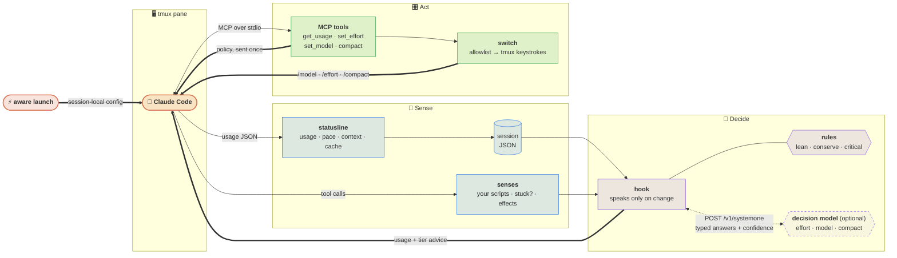

<div align="center">

<h1>Aware</h1>

<p><em>Claude Code that knows its limits, and acts on them.</em></p>

<p>
  <a href="https://github.com/JGalego/aware/actions/workflows/ci.yml"></a>
  <a href="https://github.com/tmux/tmux"></a>
  <a href="https://code.claude.com/docs/en/overview"></a>
  <a href="https://modelcontextprotocol.io/"></a>
  <a href="#"></a>
  <a href="#"></a>
</p>

</div>

Aware lets Claude Code act on its own usage. Claude Code normally can't see how much of your 5-hour and 7-day plan it has burned, or how full its context is. Aware shows it, along with how fast it's spending, and tells it exactly what to do about it: delegate bulk work to cheaper-model subagents, lower effort, switch model or compact at a natural break. Claude makes those changes itself, on its own session, and nothing global is touched. Showing the numbers is the easy part and others do it too; the point here is the acting, under a policy that knows what each move does to the prompt cache.

<div align="center">
  
</div>

<sub>Recorded with the context limits lowered and a 200k window, so the tiers change within three prompts (`docs/record.sh`).</sub>


## Getting Started

Requires `bash`, `jq`, `tmux`, `python3` (standard library only) and [Claude Code](https://code.claude.com/docs/en/overview) on your `PATH`.

```sh
curl -fsSL https://raw.githubusercontent.com/JGalego/aware/main/install.sh | bash
```

Then start a session:

```sh
aware launch [claude args]   # starts claude in tmux with aware wired in; nothing global is modified
aware launch --watch         # same, with a live dashboard in a pane beside Claude
aware watch                  # or open the dashboard on its own, in any terminal
```

Inside that session Claude gets:

- a token-efficiency policy, sent once as MCP server instructions (cached in the system prompt)
- a usage readout (5h / 7d plan usage with pace, context %, model, effort, cache state, cost), injected only when something meaningful changes
- a tier (`lean`, `conserve`, `critical`) with concrete next steps when usage or context runs high, e.g. `call set_effort medium now`
- MCP tools `get_usage`, `set_model`, `set_effort`, `compact`
- optional [senses](#senses): readings you define (machine load, other sessions, anything a script can measure), plus built-in watchers for being stuck and for what its own switches saved

## How it works



- The statusline command receives Claude Code's JSON (rate limits, cost, context, prompt cache) and saves it per session and per tmux pane.
- A `UserPromptSubmit` hook injects that readout into the model's context. Hook output stays in the history, so it only speaks when the tier, model, effort or a 10% usage band changes (`critical` repeats every prompt). Until a session has its own numbers, it borrows the account-wide 5h/7d figures from the freshest other session, so the first prompt (where the goal is set) sees usage too.
- `set_model` / `set_effort` / `compact` type `/model <x>` / `/effort <x>` / `/compact` into the tmux pane. Slash commands only run at the start of a message, so they apply once the current turn ends.
- A `PostToolUse` hook watches for repeats (the same call with identical results three times in a row, or five edits to one file within eight calls) and says so once, in the same turn.
- After `set_effort`, `set_model` or `compact`, the hook later reports what the move did to cost per turn (`effect of /effort medium: cost per turn $0.31 -> $0.19`), or says plainly when nothing dropped.
- Optionally, a decision model weighs in. Its answers are used where it is confident, and the rules decide everything else (see [Decision model](#decision-model-optional)).
- Values are checked against an allowlist before anything is typed (`AWARE_MODELS`, `AWARE_EFFORTS`; `compact` takes no arguments). Every command is logged to `~/.claude/aware/switches.log`.

### The policy

The MCP server sends the policy once, at `initialize`, and marks its tools `alwaysLoad` so they are never deferred behind tool search. In order of cost:

1. Delegate bulk work to cheaper-model subagents and match the model to the task: the cheapest (`haiku`) for mechanical work like search, reads and summaries, the middle one (`sonnet`) where judgment is needed, and the hardest reasoning stays in the main session. Only their short report enters the context; if a result looks thin, step up a model.
2. Keep reads and replies small.
3. Use effort as the main knob. On Fable 5.1+ and Opus/Sonnet/Haiku 5.5+ with an API key or subscription it keeps the prompt cache (verified live on Opus 5.5). On older models, Bedrock/Vertex/Foundry or a gateway it does not, so there aware says "at the next natural break" instead of "now", and quotes the re-read cost like it does for a model switch (`AWARE_EFFORT_CACHE` overrides the detection). If the cache-miss counter rises right after a `/effort`, the effect line says so.
4. Switch model only at a natural break with substantial work left. A switch re-reads the whole context uncached, so it is cheapest when context is small (early on, or right after `compact`) or the cache is already cold. The advice quotes the actual cost (`recache_tokens_if_cold`).
5. `compact` at a natural break when context is high, after writing down the goal and next steps.

### Tiers

The worst signal wins. **Pace** is the share of a window used divided by the share of it elapsed; above `1.0x` that limit runs out before it resets, and the readout shows when (`out ~Thu 23:01`).

| Tier | When (defaults) | Advice |
| --- | --- | --- |
| `lean` | 5h/7d ≥ 50%, context ≥ 50%, or any pace > 1 | delegate to cheaper-model subagents, keep output short, effort at most `high` |
| `conserve` | 5h/7d ≥ 80% or context ≥ 70% | effort `medium`, Opus steps down to Sonnet at a natural break, compact if context is high |
| `critical` | 5h/7d ≥ 95% | finish the step, summarize, ask the user; effort `low`, step down a model |

When a high plan window is about to reset (default: within 15 minutes, `AWARE_RESET_SOON`), the hook says so instead of advising a downgrade: switching costs a cache re-read, and waiting is cheaper than saving tokens the reset is about to refill. That only applies when every window at or above the lean limit is resetting soon.

### Senses

A sense is a reading you want Claude to know about. Put an executable in `~/.claude/aware/senses/` that prints one line, `LEVEL READING | ADVICE`, where `LEVEL` is `ok`, `warn` or `crit`:

```sh
#!/usr/bin/env bash
echo "warn 3 jobs queued | wait for the queue to drain before starting a build"
```

Senses follow the same rules as the usage readout. They are silent while `ok`, reported when their level changes (`crit` repeats each prompt), announced once when they recover, and shown in `get_usage` and in `aware watch`. They never change the usage tier; each carries its own advice. A sense gets `AWARE_SESSION_ID` and `AWARE_FILE` (the session's JSON) in its environment.

```sh
aware senses                    # what is enabled, with current readings, and the shipped examples
aware senses enable machine     # free RAM and CPU load (AWARE_MACHINE_WARN_MB=2000, AWARE_MACHINE_CRIT_MB=1000)
aware senses enable sessions    # Claude sessions active on this plan (AWARE_SESSIONS_WARN=3)
aware senses disable machine
```

Because a sense's output goes straight into Claude's context, aware treats it as untrusted: ANSI escapes and control characters are stripped, the reading is capped at 80 characters and the advice at 120, a sense that takes longer than `AWARE_SENSE_TIMEOUT` (2 s) is dropped for that prompt, and only files you own that nobody else can write to are run. A sense that fails or prints something unparseable is listed by `aware senses` and never injected. Don't print text you didn't write yourself (commit messages, web pages, issue titles) without checking it first.

### Decision model (optional)

The rules above are the default decider. You can plug in a decision model instead: any server that speaks the Jev-style `POST /v1/systemone` interface (a `state` plus typed `questions` in, a probability for every option out). Several open models do, e.g. Strands Decider, Laya, Liquid d1 and Cloudflare Clef.

```sh
# a local server
AWARE_DECIDER_URL=http://127.0.0.1:8080 aware launch

# a hosted one (here Jev; only usage numbers leave your machine unless you opt in below)
AWARE_DECIDER_URL=https://api.typesafe.ai AWARE_DECIDER_MODEL=jev-latest \
  AWARE_DECIDER_KEY="$TYPESAFE_API_KEY" aware launch
```

The key is sent as `Authorization: Bearer ...` through a private temporary header file, so it never appears in the process list or in any log.

It is asked three questions, only when the tier, model, effort or a 10% usage band changes: which effort, which model (from `AWARE_EFFORTS` / `AWARE_MODELS`), and whether to compact. Its answers are used where its confidence is at least `AWARE_DECIDER_MIN_CONF`; a costlier model or effort needs `AWARE_DECIDER_UP_CONF` when usage is under pressure (tier above `normal`), because a step up spends plan usage. Anything else (no URL, timeout, unreachable, garbled answer, low confidence) falls back to the rules, so a flaky decider never blocks a prompt.

- `AWARE_DECIDER_MODE=dry` (default) only logs each decision to `~/.claude/aware/decisions.log`, next to what Claude actually did in `switches.log`. Run it like this first and compare.
- `AWARE_DECIDER_MODE=advise` has the hook advise the decider's steps in place of the rules' steps.
- Only usage numbers are sent by default. `AWARE_DECIDER_PROMPT=1` also sends the first 300 characters of your latest prompt.

`aware decide` prints the current decision as JSON. `effort` and `model` are targets (`null` = leave as is); `said` holds what the decider actually answered, so you can see when a step up was held back by `AWARE_DECIDER_UP_CONF`.

## Configuration

| Variable | Default | Description |
| --- | --- | --- |
| `AWARE_LEAN` | `50` | 5h/7d usage % for tier `lean`. |
| `AWARE_WARN` | `80` | 5h/7d usage % for tier `conserve`. |
| `AWARE_CRIT` | `95` | 5h/7d usage % for tier `critical`. |
| `AWARE_CTX_LEAN` | `50` | Context % for tier `lean`. |
| `AWARE_CTX_WARN` | `70` | Context % for tier `conserve` (and the advice to compact). |
| `AWARE_RESET_SOON` | `15` | Minutes: when every plan window at or above the lean limit resets this soon, the advice is to wait instead of downgrade. |
| `AWARE_SENSES_DIR` | `~/.claude/aware/senses` | Folder of [sense](#senses) scripts. |
| `AWARE_SENSE_TIMEOUT` | `2` | Seconds a sense may run before it is skipped. |
| `AWARE_QUIET` | `0` | Set to `1` to inject only the tier advice, never the plain readout. |
| `AWARE_EVERY_TURN` | `0` | Set to `1` to inject on every prompt instead of only on change. |
| `AWARE_ALLOW_COMPACT` | `1` | Set to `0` to refuse `compact`. |
| `AWARE_MODELS` | `haiku sonnet opus` | Allowed model names, ordered cheapest to most expensive. Limits `set_model`, sets the step-down chain, and picks the models named in the delegation advice. |
| `AWARE_EFFORTS` | `low medium high xhigh max` | Allowed effort levels for effort switches. |
| `AWARE_DECIDER_URL` | empty | Decision model server (`POST <url>/v1/systemone`). Empty means the rules decide. |
| `AWARE_DECIDER_KEY` | empty | Bearer token for a hosted decider. |
| `AWARE_DECIDER_MODEL` | empty | Model name for hosted deciders that need one (e.g. `jev-latest`). |
| `AWARE_DECIDER_MODE` | `dry` | `dry` logs decisions only; `advise` lets the hook advise them. |
| `AWARE_DECIDER_MIN_CONF` | `0.6` | Below this confidence a field falls back to the rules. |
| `AWARE_DECIDER_UP_CONF` | `0.85` | Confidence needed to advise a costlier model or effort above tier `normal` (at `normal`, `AWARE_DECIDER_MIN_CONF` applies). |
| `AWARE_DECIDER_TIMEOUT` | `2` | Seconds to wait for the decider before using the rules. |
| `AWARE_DECIDER_PROMPT` | `0` | Set to `1` to also send your latest prompt (first 300 characters). |
| `AWARE_EFFORT_CACHE` | `auto` | Whether an effort change keeps the prompt cache. `auto` = yes only on Fable 5.1+ and Opus/Sonnet/Haiku 5.5+, and not when `CLAUDE_CODE_USE_BEDROCK`/`_VERTEX`/`_FOUNDRY` or a non-Anthropic `ANTHROPIC_BASE_URL` is set. `yes` / `no` force it. |
| `AWARE_KEEP_DEFAULT` | `1` | Restore your previous default model/effort in `settings.json` after a switch; `0` leaves the new default in place. |
| `AWARE_AUTOCONFIRM` | `0` | Set to `1` to automatically confirm a switch dialog naming the requested model. |
| `AWARE_CONFIRM_WAIT` | `600` | Maximum seconds to wait for the matching model-switch dialog when auto-confirm is enabled. |

`aware launch` forwards every `AWARE_*` variable to claude, e.g. `AWARE_AUTOCONFIRM=1 aware launch`.

## Development

Install [pre-commit](https://pre-commit.com/#install), then enable and run the checks:

```sh
pre-commit install
pre-commit run --all-files
```

The hooks check whitespace, JSON/YAML, merge conflicts, Python syntax, and Bash syntax (including the extensionless launcher).

Run the tests with `./test.sh`. They use a fake `HOME`, a private tmux server and a pinned clock (`AWARE_NOW`), and touch nothing real. CI runs both on every push and pull request.

## Verified Live (Claude Code 2.1.328–2.1.329)

- The `--settings` statusline and hook and the `--mcp-config` tools load, and the hook's usage line reaches the model's context. A project-level hook and aware's hook both fire.
- The MCP `instructions` reach the model; with `alwaysLoad` the tools are in the prompt, not deferred.
- The hook injects once, then stays silent while nothing changes. The first prompt sees borrowed account-wide limits.
- `set_effort` applies after the turn ends and keeps the prompt cache (0 misses across the change; Opus 5.5 on a subscription, not re-checked on other models or providers). Since 2.1.328 `/effort` saves to `modelSettings.<model>.effortLevel` in `settings.json`; aware restores it.
- `compact` runs `/compact` after the turn ends; context dropped to 0% and the model wrote down the goal first.
- At a (simulated) 88% 5h usage, the model called `set_effort medium` first, as the advice named it, then answered with one grep and one ranged read. With the tools deferred, or with the advice worded vaguely, it ignored the advice.
- `set_model` applies live. Claude Code shows a "Switch model?" dialog (the prompt cache is dropped) and `/model` saves the choice as your default; aware restores your previous default.
- With `AWARE_AUTOCONFIRM=1`, aware pressed Enter on the real dialog about a second after the switch, only once it named the requested model, and logged it to `switches.log`.

## Known Limits

- 5h/7d numbers only exist for Pro/Max/Ultra subscribers, after the first response.
- Typing into the pane can interleave with text you are typing at that moment.
- Model switching is not free (cache drop), so it only pays off for long remaining work; effort changes are the cheap lever, but only where they keep the cache (see the policy). The model/provider detection is a guess from the model id and environment variables; use `AWARE_EFFORT_CACHE` if it is wrong for your setup.
- Nobody has shown that injecting usage helps. A placebo-controlled study of coding agents ([arXiv:2611.21614](https://arxiv.org/abs/2611.21614), open models only) found that telling the agent its budget did no better than an unrelated sentence; the gains came from enforced limits. Aware is untested against that: its bet is that concrete advice plus tools to act on it is different from disclosure, and it has no controlled evaluation yet.
- The usage numbers are account-wide (shared by every session on the plan); cost and context are per session. A subagent does not see aware's readout.
- Whether the model follows the advice is up to the model. It did when the advice named an exact call and the numbers backed it up; with low numbers and a forced tier it ignored even that.
- Stuck detection is a heuristic on tool calls (identical call and result, or many edits to one file). It cannot tell polling from looping when the output happens to repeat, so it only says "stuck?" and leaves the decision to Claude.
- The measured effect of a switch compares cost per turn over a few turns on each side. Turns differ in size, so treat it as a hint, not a benchmark.
- Borrowed 5h/7d figures on the first prompt are as old as the other session's last response.
- Not tested: merging with your own user-level hooks/statusline (only project-level was exercised).
- The decision model is unproven: it looked sensible on synthetic scenarios against hosted Jev, but no model card covers choosing a model or effort for coding work. Use `dry` mode logs as evidence before `advise`.
- A local 2B decision model on a busy CPU was too slow (48 s per request); slower than `AWARE_DECIDER_TIMEOUT` falls back to the rules.

## License

[MIT](LICENSE)
